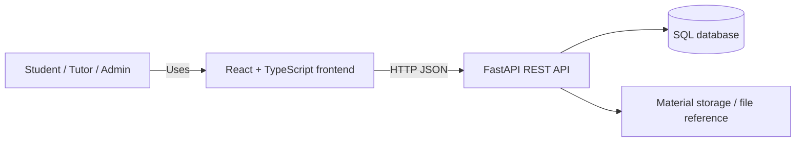
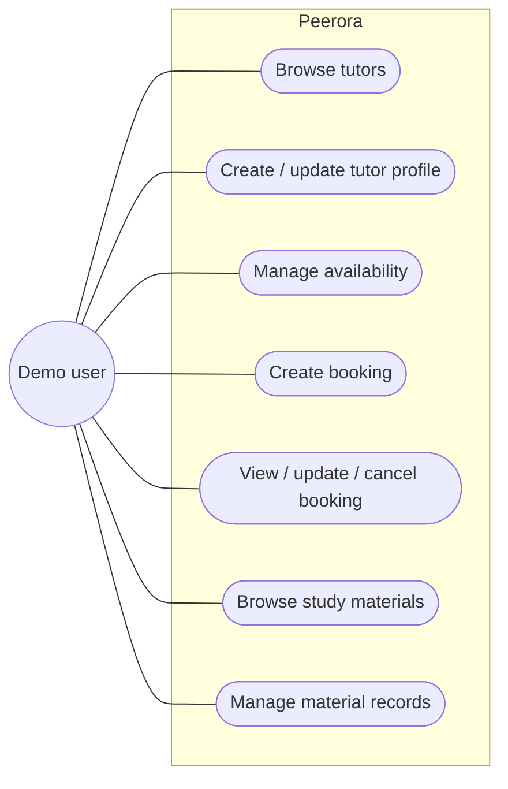
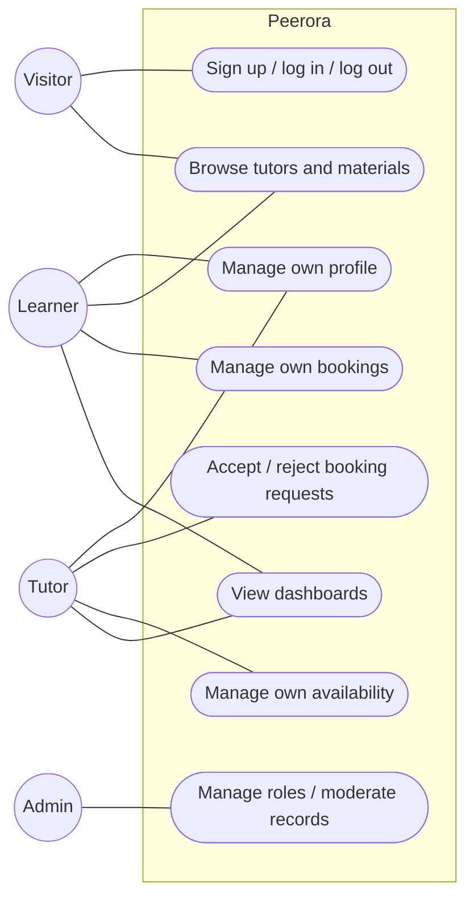
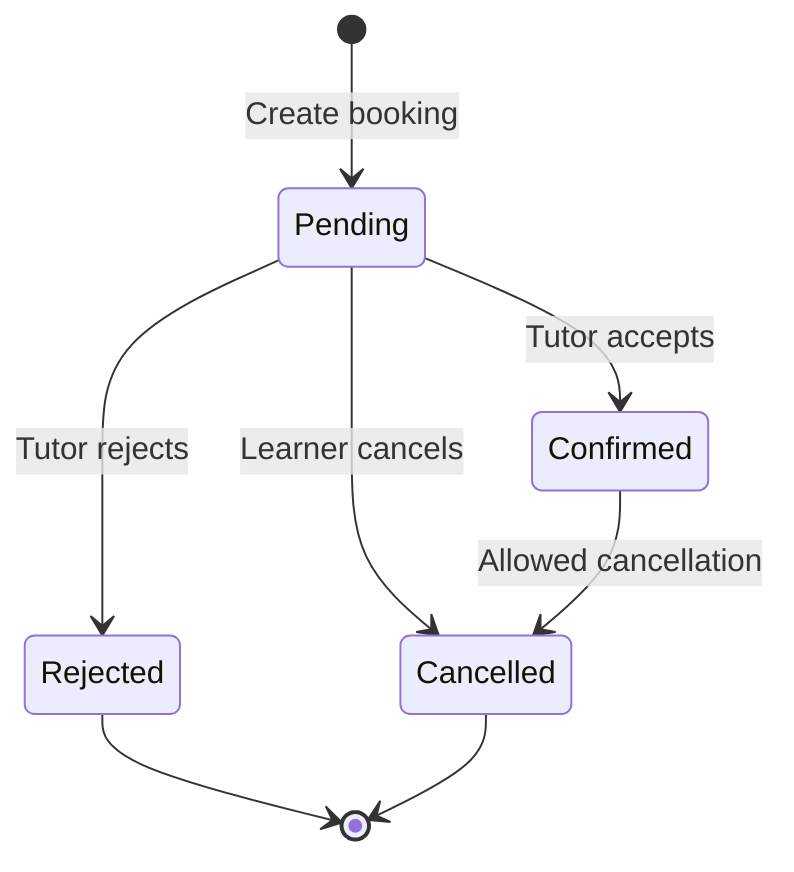

# Software Requirements Specification (SRS) — Peerora

| Field | Value |
|---|---|
| Product | Peerora |
| Version | MVP + Beta |
| Releases | MVP — Mid-term, Beta — Final |
| Status | Draft |
| Related docs | [Product Requirements Document (PRD)](01-prd.md), [Technical Design Document (TDD)](03-tdd.md) |

Every requirement has a **Release** column: **MVP** is built for the mid-term; **Beta** is added for the final.

**Documents in this set**

| Short form | Full form | Purpose | File |
|---|---|---|---|
| PRD | Product Requirements Document | What we build and why | [01-prd.md](01-prd.md) |
| SRS | Software Requirements Specification | Exact requirements, permissions and acceptance criteria (this document) | [02-srs.md](02-srs.md) |
| TDD | Technical Design Document | How we build it: architecture, data model, API | [03-tdd.md](03-tdd.md) |

## 1. Introduction

### 1.1 Purpose
This document defines the functional and non-functional requirements for Peerora. The MVP focuses on tutor discovery, availability, booking CRUD, and simple study-material sharing. The Beta adds accounts, roles, permission checks, dashboards, stronger booking rules, material access controls, and deployment.

### 1.2 Scope
- **MVP:** users can browse and manage tutor records, availability slots, booking records, and study-material metadata through a React + TypeScript frontend connected to a FastAPI REST API. The application runs locally.
- **Beta:** users sign up and log in; learners and tutors access their own relevant records; tutors handle requests; admins can moderate selected records; and the application is deployed.
- **Out of scope:** see [PRD, section 5](01-prd.md#5-scope).

### 1.3 Definitions

| Term | Meaning |
|---|---|
| CRUD | Create, Read, Update, Delete |
| REST | API style where resources are accessed with HTTP methods such as GET, POST, PATCH and DELETE |
| Tutor profile | A record describing a peer tutor, including subjects and a short introduction |
| Availability slot | A start and end time when a tutor may accept a session |
| Booking | A learner's request for a tutoring session with a tutor |
| Booking status | The current state of a booking: pending, confirmed, rejected, or cancelled |
| Study material | A record describing a learning resource, with a file reference or supported upload |
| Authentication | Verifying who a user is |
| Authorization | Deciding which actions a user may perform |
| RBAC | Role-Based Access Control: permissions depend on a user's role |
| JWT | JSON Web Token used to represent an authenticated session |
| Security scope | A permission or access rule checked by the backend for a request |
| Client | Any caller of the API, including the React frontend, browser, curl, or Postman |
| OpenAPI | Standard API description generated by FastAPI and shown at `/api/docs` |

## 2. Overall description

### 2.1 System context

### 2.2 Users and roles

| Role | Release | Description |
|---|---|---|
| Demo user | MVP | Uses the local demo interface and shared sample records; there is no real account security in this release |
| Visitor | Beta | Not logged in; may register, log in, and view public tutor profiles and public material listings |
| Learner | Beta | Searches tutors, manages own booking requests, and views relevant study materials |
| Tutor | Beta | Manages own tutor profile and availability, and responds to booking requests |
| Learner and tutor | Beta | One account may use learner and tutor features if it has a tutor profile |
| Admin | Beta | Manages user roles and can moderate records through explicitly protected admin endpoints |

The `admin` role is global. Tutor capabilities are associated with a tutor profile; a registered user may also be a learner.

### 2.3 Use cases

**MVP**

**Beta**

### 2.4 Constraints
- C-1: The frontend must use React.js and TypeScript.
- C-2: The backend must use Python and FastAPI.
- C-3: Frontend-backend communication must use REST APIs with JSON request and response bodies, except for supported file uploads.
- C-4: Backend routes use the `/api` prefix.
- C-5: The database stores application records and material metadata; large file contents should not be stored directly in database columns.
- C-6: MVP development and demonstration must be possible locally.
- C-7: Beta permissions must be enforced on the server, not only by hiding frontend controls.
- C-8: No AI integration is required.

### 2.5 Assumptions
- A-1: MVP demo data may be used before authentication is implemented.
- A-2: The team can install the Python and Node.js dependencies required by the project.
- A-3: The local MVP may store a file reference or use a basic local upload flow; the Beta must use a storage approach suitable for the selected deployment.
- A-4: All session times are stored consistently, preferably in UTC, and displayed in the user's local time where practical.
- A-5: The first admin account may be configured manually for the course demonstration.

## 3. Functional requirements

### 3.1 Tutor profiles — MVP

| ID | Requirement | Release | Story |
|---|---|---|---|
| FR-01 | The system shall create a tutor profile with a display name, subjects, short bio, and optional contact or meeting information. | MVP | US-02 |
| FR-02 | The system shall list tutor profiles and support filtering by subject. | MVP | US-01 |
| FR-03 | The system shall return one tutor profile by ID. | MVP | US-01 |
| FR-04 | The system shall update and delete an existing tutor profile. | MVP | US-02 |
| FR-05 | The system shall reject invalid tutor-profile fields with a `422` response identifying the invalid field. | MVP | US-09 |

### 3.2 Availability — MVP

| ID | Requirement | Release | Story |
|---|---|---|---|
| FR-06 | The system shall create an availability slot for a tutor with a start time and end time. | MVP | US-03 |
| FR-07 | The system shall list availability slots for a tutor, ordered by start time. | MVP | US-03 |
| FR-08 | The system shall return, update, and delete an availability slot by ID. | MVP | US-03 |
| FR-09 | The system shall reject a slot if its end time is not later than its start time. | MVP | US-09 |

### 3.3 Bookings — MVP

| ID | Requirement | Release | Story |
|---|---|---|---|
| FR-10 | The system shall create a booking with learner name or demo identifier, tutor ID, subject, start time, end time, and optional note. | MVP | US-04 |
| FR-11 | The system shall list bookings and support filtering by tutor and status where applicable. | MVP | US-05 |
| FR-12 | The system shall return one booking by ID. | MVP | US-05 |
| FR-13 | The system shall update supported booking fields and cancel a booking by changing its status to `cancelled`. | MVP | US-06 |
| FR-14 | The system shall assign new bookings the status `pending`. | MVP | US-04 |
| FR-15 | The system shall reject bookings with an invalid time range or a missing tutor. | MVP | US-09 |

### 3.4 Study materials — MVP

| ID | Requirement | Release | Story |
|---|---|---|---|
| FR-16 | The system shall create a study-material record with title, subject, description, uploader label, and file reference. | MVP | US-08 |
| FR-17 | The system shall list and view study-material records and support filtering by subject. | MVP | US-07 |
| FR-18 | The system shall update and delete a study-material record. | MVP | US-08 |
| FR-19 | The system shall support a basic file reference or a simple local upload/download flow when file storage is configured. | MVP | US-08 |

### 3.5 Frontend integration and API support — MVP

| ID | Requirement | Release | Story |
|---|---|---|---|
| FR-20 | The React frontend shall call the FastAPI backend for tutor, availability, booking, and material operations. | MVP | US-09 |
| FR-21 | The system shall expose `GET /api/health` returning `{"status": "ok"}`. | MVP | US-10 |
| FR-22 | The system shall expose interactive API documentation at `/api/docs`. | MVP | US-10 |
| FR-23 | The system shall use appropriate HTTP status codes and return understandable validation errors. | MVP | US-09 |

### 3.6 Authentication and profile — Beta

| ID | Requirement | Release | Story |
|---|---|---|---|
| FR-24 | The system shall allow a visitor to register with name, email, and password. Email shall be unique and case-insensitive. | Beta | US-11 |
| FR-25 | The system shall authenticate a user with email and password and provide a session token. | Beta | US-12 |
| FR-26 | The system shall support logout and invalidate the active refresh/session token if refresh-token sessions are implemented. | Beta | US-12 |
| FR-27 | The system shall return the authenticated user's profile without exposing the password or password hash. | Beta | US-13 |
| FR-28 | The system shall allow a user to update permitted profile fields, but not change their own role through the profile endpoint. | Beta | US-13 |
| FR-29 | Protected endpoints shall return `401` when the request has no valid authentication token. | Beta | US-12 |

### 3.7 Authorization, RBAC, and ownership — Beta

| ID | Requirement | Release | Story |
|---|---|---|---|
| FR-30 | The system shall support `learner`, `tutor`, and `admin` permissions; a registered user may use learner features and tutor features when a tutor profile exists. | Beta | US-14, US-15 |
| FR-31 | A user shall be able to update or delete only their own profile and tutor availability, except for authorized admin actions. | Beta | US-16 |
| FR-32 | A learner shall be able to view and manage only their own bookings; a tutor shall be able to view and respond to bookings addressed to that tutor. | Beta | US-14, US-15 |
| FR-33 | A non-admin user calling an admin-only endpoint shall receive `403 Forbidden`. | Beta | US-20 |
| FR-34 | The system shall check role, ownership, and required security scope or permission on the server for every protected action. | Beta | US-14, US-19, US-20 |

### 3.8 Booking workflow and dashboards — Beta

| ID | Requirement | Release | Story |
|---|---|---|---|
| FR-35 | The tutor shall be able to accept or reject a pending booking request. | Beta | US-15 |
| FR-36 | The learner shall be able to cancel their own booking, subject to the implemented status rules. | Beta | US-14 |
| FR-37 | The system shall reject invalid booking status transitions. | Beta | US-15 |
| FR-38 | The system should prevent overlapping confirmed bookings for the same tutor. | Beta | US-18 |
| FR-39 | The learner dashboard shall show the learner's bookings and their statuses. | Beta | US-17 |
| FR-40 | The tutor dashboard shall show incoming booking requests, upcoming confirmed sessions, and the tutor's availability. | Beta | US-15 |

### 3.9 Study-material access and administration — Beta

| ID | Requirement | Release | Story |
|---|---|---|---|
| FR-41 | The system shall validate supported material file types and maximum upload size when file upload is enabled. | Beta | US-19 |
| FR-42 | A user shall be able to update or delete only material records they own, except for authorized admin moderation. | Beta | US-19 |
| FR-43 | The system shall not expose private filesystem paths or storage credentials in API responses. | Beta | US-19 |
| FR-44 | An admin shall be able to list users and change user roles through protected endpoints. | Beta | US-20 |
| FR-45 | An admin shall be able to remove an inappropriate material record. | Beta | US-20 |
| FR-46 | The system shall provide learner and tutor dashboards using data filtered by the authenticated user's permissions. | Beta | US-17, US-21 |

### 3.10 Validation rules

| Field | Rule | Release |
|---|---|---|
| Tutor display name | Required, 1–100 characters after trimming | MVP |
| Subjects | Required, at least one subject; each subject 1–80 characters | MVP |
| Tutor bio | Optional, maximum 1000 characters | MVP |
| Availability start/end | Valid datetime; end must be later than start | MVP |
| Booking subject | Required, 1–100 characters | MVP |
| Booking note | Optional, maximum 1000 characters | MVP |
| Booking status | `pending`, `confirmed`, `rejected`, or `cancelled` | MVP |
| Material title | Required, 1–200 characters | MVP |
| Material description | Optional, maximum 1000 characters | MVP |
| Material subject | Required, 1–100 characters | MVP |
| Email | Valid email, maximum 254 characters, stored lowercase | Beta |
| Password | 8–128 characters minimum/maximum length | Beta |
| User name | 1–100 characters | Beta |
| Role | `learner`, `tutor`, or `admin`, according to the role model | Beta |
| Upload file | Allowlisted file types and configured maximum size | Beta |

### 3.11 Booking states

A new booking starts as `pending`. The Beta must enforce permitted transitions on the server. A rejected or cancelled booking cannot be confirmed again unless the project explicitly implements a new-request workflow.

### 3.12 Permission matrix — Beta

| Action | Visitor | Learner | Tutor | Admin |
|---|---|---|---|---|
| Register / log in | Yes | — | — | — |
| Browse public tutor profiles | Yes | Yes | Yes | Yes |
| View public material listings | Yes | Yes | Yes | Yes |
| Manage own profile | No | Yes | Yes | Yes |
| Create a booking | No | Yes | Yes | Yes |
| View own bookings | No | Yes | Yes | Yes |
| Accept/reject booking addressed to tutor | No | No | Yes, own bookings only | Authorized moderation only |
| Manage own availability | No | If tutor profile exists | Yes | Yes |
| Create a material record | No | Yes | Yes | Yes |
| Update/delete another user's material | No | No | No | Yes |
| List users / change roles | No | No | No | Yes |
| Call protected endpoints without a token | No | No (`401`) | No (`401`) | No (`401`) |

### 3.13 Status codes

| Case | Code | Release |
|---|---|---|
| Resource created | `201 Created` | MVP |
| Read or update succeeded | `200 OK` | MVP |
| Resource deleted successfully | `204 No Content` | MVP |
| Invalid input | `422 Unprocessable Content` | MVP |
| Resource not found | `404 Not Found` | MVP |
| Duplicate email or conflicting booking | `409 Conflict` | Beta |
| Missing, invalid, or expired token | `401 Unauthorized` | Beta |
| Authenticated user lacks permission | `403 Forbidden` | Beta |
| Unexpected server error | `500 Internal Server Error` | MVP |

## 4. Non-functional requirements

| ID | Category | Requirement | Release |
|---|---|---|---|
| NFR-01 | Performance | Normal list and detail requests should respond within 500 ms in the local demo, excluding startup and large file transfer. | MVP |
| NFR-02 | Persistence | Tutor, availability, booking, and material metadata must remain in the database after an application restart. | MVP |
| NFR-03 | Usability | The main tutoring workflow must be accessible through the React frontend without manually calling the API. | MVP |
| NFR-04 | API documentation | Endpoints and request/response schemas must be available at `/api/docs`. | MVP |
| NFR-05 | Maintainability | Backend code should separate routes, schemas, models, services, and database access. | MVP |
| NFR-06 | Integration | The frontend must show loading, success, empty, and error states for core API operations. | MVP |
| NFR-07 | Security | Secrets and database credentials must not be committed to Git. | MVP |
| NFR-08 | Validation | The backend must validate all client input; frontend validation is supplementary. | MVP |
| NFR-09 | Security | Passwords must be hashed using a suitable password-hashing algorithm and never stored or returned in plain text. | Beta |
| NFR-10 | Authorization | Every protected action must be authorized by the backend, including direct API requests that bypass the frontend. | Beta |
| NFR-11 | Privacy | Users must not be able to retrieve or modify another user's private bookings or tutor availability. | Beta |
| NFR-12 | File safety | Uploads must be size-limited and checked against an allowlist; file paths and credentials must not be exposed. | Beta |
| NFR-13 | Deployment | The deployed frontend, API, database, and any file storage must be configured and tested together. | Beta |
| NFR-14 | Reliability | Booking status changes and conflict checks must be performed consistently in the backend. | Beta |

## 5. Acceptance criteria

### MVP

**AC-01 Browse tutors (FR-02, FR-03)**
- Given several tutor profiles exist,
- When the frontend requests the tutor list or filters by subject,
- Then the API returns matching profiles with `200 OK`.

**AC-02 Create and validate tutor profile (FR-01, FR-05)**
- Given valid profile data,
- When the client sends `POST /api/v1/tutors`,
- Then the API returns `201 Created` with the saved profile.
- When required fields are missing or invalid,
- Then the API returns `422` and identifies the invalid field.

**AC-03 Manage availability (FR-06–FR-09)**
- Given a tutor exists,
- When a valid start and end time are submitted,
- Then the slot is saved and returned.
- When the end time is earlier than or equal to the start time,
- Then the API returns `422`.

**AC-04 Create booking (FR-10, FR-14, FR-15)**
- Given the selected tutor exists and the booking time range is valid,
- When the client sends `POST /api/v1/bookings`,
- Then the API returns `201` and the booking status is `pending`.
- When the tutor does not exist or the time range is invalid,
- Then the API returns an appropriate `404` or `422`.

**AC-05 View, update, and cancel booking (FR-11–FR-13)**
- Given a booking exists,
- When the client requests the booking by ID, the API returns `200`.
- When the client cancels it through the supported update operation,
- Then its status becomes `cancelled`.

**AC-06 Study-material records (FR-16–FR-19)**
- Given valid material metadata,
- When the client creates a material record,
- Then the API returns `201` with the stored record.
- The material list can be filtered by subject, and a saved file reference is returned without exposing server secrets.

**AC-07 Frontend integration (FR-20)**
- When a user browses tutors, creates a booking, or browses materials in the React interface,
- Then the frontend sends requests to FastAPI and renders the returned data and errors.

**AC-08 Health and API docs (FR-21, FR-22)**
- `GET /api/health` returns `200` with `{"status": "ok"}`.
- `/api/docs` displays the interactive API documentation.

### Beta

**AC-09 Registration and login (FR-24–FR-29)**
- When a visitor registers with valid unique email and password, the API creates an account without returning a password hash.
- A duplicate email returns `409`.
- Valid credentials allow login; invalid credentials return `401`.
- Protected endpoints reject missing or invalid tokens with `401`.

**AC-10 Ownership checks (FR-31, FR-32, FR-34)**
- Given user A owns a booking or availability slot,
- When user B attempts to modify it,
- Then the API denies the operation and does not change the record.

**AC-11 Tutor booking response (FR-35–FR-37)**
- Given a pending booking belongs to tutor A,
- When tutor A accepts or rejects it,
- Then the status changes to the selected valid state.
- When another tutor attempts the same action, the API returns `403` or `404` according to the information-disclosure policy.

**AC-12 Prevent overlapping confirmed bookings (FR-38)**
- Given a tutor already has a confirmed booking for a time range,
- When another overlapping booking is confirmed,
- Then the API rejects the conflicting confirmation and keeps the existing booking unchanged.

**AC-13 Dashboards (FR-39, FR-40, FR-46)**
- A learner sees only their own bookings.
- A tutor sees only booking requests and sessions associated with their tutor profile.

**AC-14 Material ownership and validation (FR-41–FR-43)**
- A non-owner cannot update or delete another user's material.
- Unsupported file types or files larger than the configured limit are rejected.
- API responses do not expose private filesystem paths or storage credentials.

**AC-15 Admin actions (FR-44, FR-45)**
- A non-admin calling a role-management endpoint receives `403`.
- An admin can list users, change a role, and remove an inappropriate material record.

**AC-16 Deployed workflow (FR-46)**
- The deployed app can complete the primary journey: browse tutors, view availability, create a booking, and view its status.
- The supporting material list is also available.

## 6. Traceability

| Story | Requirements | Endpoint / interface (see [TDD, section 6](03-tdd.md#6-rest-api-design)) | Release |
|---|---|---|---|
| US-01 | FR-02, FR-03 | `GET /api/v1/tutors`, `GET /api/v1/tutors/{id}` | MVP |
| US-02 | FR-01, FR-04, FR-05 | `/api/v1/tutors` | MVP |
| US-03 | FR-06–FR-09 | `/api/v1/tutors/{tutor_id}/availability` | MVP |
| US-04 | FR-10, FR-14, FR-15 | `POST /api/v1/bookings` | MVP |
| US-05 | FR-11, FR-12 | `GET /api/v1/bookings`, `GET /api/v1/bookings/{id}` | MVP |
| US-06 | FR-13 | `PATCH /api/v1/bookings/{id}` | MVP |
| US-07 | FR-17 | `GET /api/v1/materials` | MVP |
| US-08 | FR-16, FR-18, FR-19 | `/api/v1/materials` | MVP |
| US-09 | FR-05, FR-09, FR-15, FR-20, FR-23 | All core endpoints | MVP |
| US-10 | FR-21, FR-22 | `GET /api/health`, `/api/docs` | MVP |
| US-11, US-12 | FR-24–FR-26, FR-29 | `/api/v1/auth/*` | Beta |
| US-13 | FR-27, FR-28 | `/api/v1/users/me` | Beta |
| US-14 | FR-30, FR-32, FR-34, FR-36, FR-39 | `/api/v1/bookings` | Beta |
| US-15 | FR-30, FR-32, FR-35, FR-37, FR-40 | `/api/v1/tutor/bookings` | Beta |
| US-16 | FR-31 | `/api/v1/tutors/me/availability` | Beta |
| US-17 | FR-39, FR-46 | `/api/v1/dashboard/learner` | Beta |
| US-18 | FR-38 | Booking confirmation service | Beta |
| US-19 | FR-41–FR-43 | `/api/v1/materials` | Beta |
| US-20 | FR-33, FR-44, FR-45 | `/api/v1/admin/*` | Beta |
| US-21 | FR-46 | Deployed frontend and API | Beta |