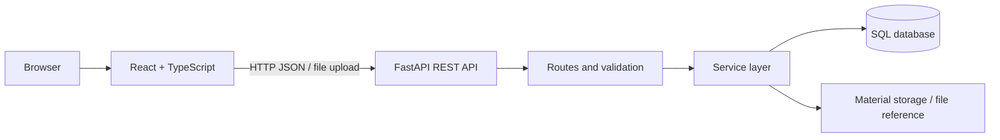
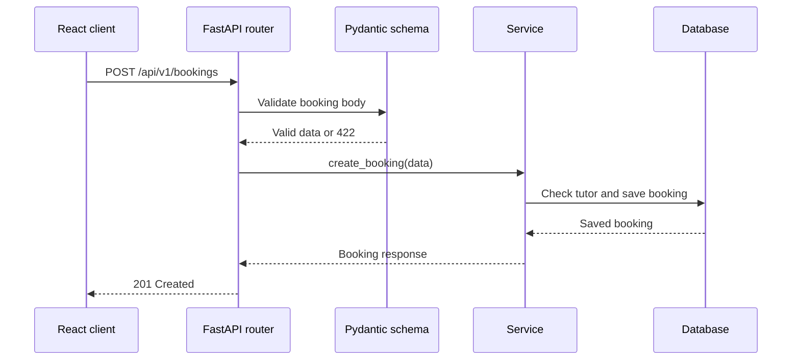
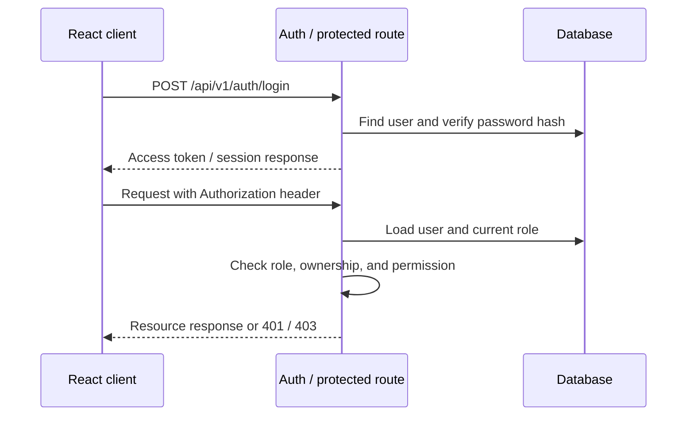
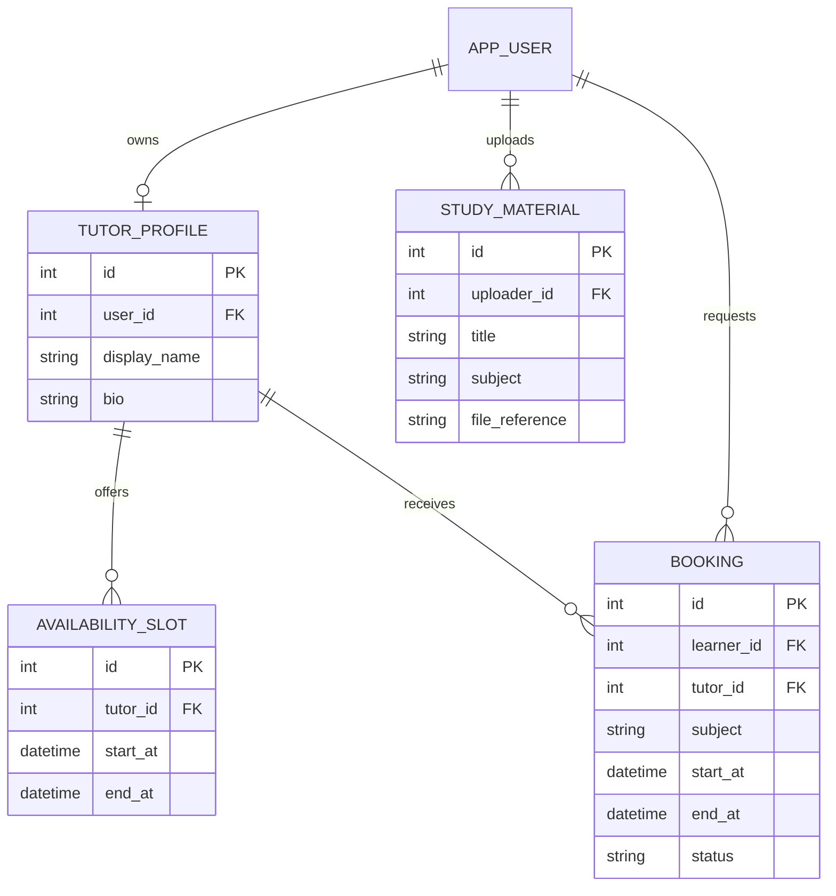
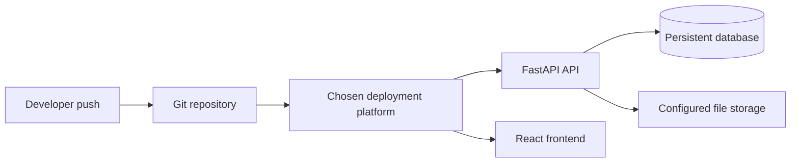

# Technical Design Document (TDD) — Peerora

| Field | Value |
|---|---|
| Product | Peerora |
| Version | MVP + Beta |
| Releases | MVP — Mid-term, Beta — Final |
| Status | Draft |
| Related docs | [Product Requirements Document (PRD)](01-prd.md), [Software Requirements Specification (SRS)](02-srs.md) |

Sections and tables are marked **MVP** or **Beta**. Build the MVP parts for the mid-term; the Beta parts extend them for the final.

**Documents in this set**

| Short form | Full form | Purpose | File |
|---|---|---|---|
| PRD | Product Requirements Document | What we build and why | [01-prd.md](01-prd.md) |
| SRS | Software Requirements Specification | Exact requirements, permissions and acceptance criteria | [02-srs.md](02-srs.md) |
| TDD | Technical Design Document | How we build it: architecture, data model, API (this document) | [03-tdd.md](03-tdd.md) |

## 1. Overview

- **MVP:** a React + TypeScript frontend connected to a FastAPI REST API. The API stores tutor profiles, availability slots, bookings, and study-material metadata in a SQL database. The application runs locally.
- **Beta:** add authentication, profile management, role-based access control, server-side ownership checks, learner/tutor dashboards, booking conflict rules, secure material access, and deployment.
- Tutoring is the primary workflow. Study-material sharing remains a small supporting feature.

## 2. Tech stack

| Layer | Choice | Why | Release |
|---|---|---|---|
| Frontend | React.js + TypeScript | Component-based UI with type checking | MVP |
| Frontend tooling | Vite | Fast local development and build process | MVP |
| API | FastAPI | Request validation, type hints, and automatic OpenAPI docs | MVP |
| Validation / schemas | Pydantic | Defines and validates API request and response bodies | MVP |
| ORM | SQLModel or SQLAlchemy | Maps Python models to relational database tables | MVP |
| Database (local) | SQLite | Simple local setup for course development | MVP |
| Database (deployment) | PostgreSQL | Suitable relational database for the deployed application | Beta |
| API client | Fetch API in a shared TypeScript service module | Keeps frontend requests consistent and easy to update | MVP |
| File handling | Metadata and file reference; local upload only if configured | Keeps material sharing small and avoids storing file bytes in database rows | MVP |
| Authentication | JWT access token or equivalent secure session design | Supports authenticated API requests | Beta |
| Password hashing | Argon2 or bcrypt through a maintained library | Passwords must not be stored in plain text | Beta |
| File storage | Configured persistent storage or controlled file service | Avoids relying on ephemeral deployment disk | Beta |
| Deployment | Selected platform for frontend/API and a hosted database | Makes the final workflow accessible for evaluation | Beta |

Exact hosting and file-storage providers will be selected based on course requirements and free-tier availability. Do not commit credentials or private environment values.

## 3. Architecture



The frontend communicates only with FastAPI. The backend validates inputs, applies business rules, checks permissions in the Beta, and accesses the database. The browser must not connect directly to the database.

### 3.1 Request flow — MVP



### 3.2 Authentication and authorization flow — Beta



## 4. Project structure

```text
peerora/
  backend/
    app/
      main.py                 # FastAPI application and router registration
      config.py               # Environment-based configuration
      database.py             # Engine, session dependency, local database setup
      core/
        security.py           # Beta: password hashing and token helpers
        permissions.py        # Beta: role and ownership dependencies
      tutors/
        router.py             # Tutor profile endpoints
        schemas.py             # Tutor request and response schemas
        models.py             # Tutor profile model
        service.py            # Tutor business rules
      availability/
        router.py             # Availability endpoints
        schemas.py
        models.py
        service.py
      bookings/
        router.py             # Booking endpoints and tutor responses
        schemas.py
        models.py
        service.py            # Status transitions and conflict checks
      materials/
        router.py             # Material metadata and optional upload endpoints
        schemas.py
        models.py
        service.py
      auth/                   # Beta: signup, login, logout
      users/                  # Beta: profile endpoints
      dashboard/              # Beta: learner and tutor dashboard endpoints
      admin/                  # Beta: protected administration endpoints
    requirements.txt
    .env.example
  frontend/
    src/
      App.tsx
      pages/                  # Tutors, tutor details, bookings, materials
      components/             # Forms, cards, lists, loading and error states
      services/
        api.ts                # Shared fetch wrapper and API functions
      types/                  # TypeScript API types
      hooks/                  # Optional reusable data hooks
      layouts/                # Navigation and page layout
  docs/
    01-prd.md
    02-srs.md
    03-tdd.md
```

Keep each feature's route, schema, model, and service together. Routers should handle HTTP concerns; services should contain business rules and database operations. Avoid putting all application logic in `main.py`.

## 5. Data model

### 5.1 `tutor_profile` table — MVP

| Column | Type | Rules |
|---|---|---|
| `id` | integer | Primary key, auto increment |
| `display_name` | varchar(100) | Not null |
| `subjects` | JSON or normalized related records | At least one subject |
| `bio` | varchar(1000) | Nullable |
| `contact_info` | varchar(200) | Nullable; avoid exposing private contact information by default |
| `created_at` | timestamp | Not null |
| `updated_at` | timestamp | Not null |

### 5.2 `availability_slot` table — MVP

| Column | Type | Rules |
|---|---|---|
| `id` | integer | Primary key |
| `tutor_id` | integer | Foreign key to `tutor_profile.id` |
| `start_at` | timestamp | Not null |
| `end_at` | timestamp | Not null; later than `start_at` |
| `created_at` | timestamp | Not null |

### 5.3 `booking` table — MVP

| Column | Type | Rules |
|---|---|---|
| `id` | integer | Primary key |
| `learner_label` | varchar(100) | Required in MVP demo; Beta uses `learner_id` |
| `tutor_id` | integer | Foreign key to `tutor_profile.id` |
| `subject` | varchar(100) | Not null |
| `start_at` | timestamp | Not null |
| `end_at` | timestamp | Not null; later than `start_at` |
| `note` | varchar(1000) | Nullable |
| `status` | varchar(20) | `pending`, `confirmed`, `rejected`, `cancelled`; default `pending` |
| `created_at`, `updated_at` | timestamp | Not null |

### 5.4 `study_material` table — MVP

| Column | Type | Rules |
|---|---|---|
| `id` | integer | Primary key |
| `title` | varchar(200) | Not null |
| `subject` | varchar(100) | Not null |
| `description` | varchar(1000) | Nullable |
| `uploader_label` | varchar(100) | Required in MVP demo; Beta uses `uploader_id` |
| `file_reference` | varchar(500) | Nullable; do not store file bytes here |
| `created_at`, `updated_at` | timestamp | Not null |

### 5.5 Additional tables — Beta

**`app_user`**

| Column | Type | Rules |
|---|---|---|
| `id` | integer | Primary key |
| `name` | varchar(100) | Not null |
| `email` | varchar(254) | Unique, stored lowercase |
| `password_hash` | varchar | Not null; never returned by API |
| `role` | varchar(20) | `learner`, `tutor`, or `admin` based on chosen role model |
| `created_at`, `updated_at` | timestamp | Not null |

**Beta ownership fields**

| Table | Field | Purpose |
|---|---|---|
| `tutor_profile` | `user_id` | Links a tutor profile to its owner |
| `availability_slot` | `tutor_id` | Identifies which tutor owns the slot |
| `booking` | `learner_id` | Identifies the learner who created the booking |
| `study_material` | `uploader_id` | Identifies the user who uploaded the material |

The tutor profile may be linked to a user account. A user without a tutor profile can still use learner functionality. If separate roles are used, document how a user can become a tutor and how a user with both capabilities is represented.



### 5.6 Request and response schemas

| Schema | Used for | Fields | Release |
|---|---|---|---|
| `TutorCreate` | Create tutor profile | `display_name`, `subjects`, `bio?`, `contact_info?` | MVP |
| `TutorUpdate` | Update tutor profile | Optional tutor profile fields | MVP |
| `TutorRead` | Tutor response | `id` and public tutor fields | MVP |
| `AvailabilityCreate` | Create slot | `start_at`, `end_at` | MVP |
| `AvailabilityRead` | Slot response | `id`, `tutor_id`, `start_at`, `end_at` | MVP |
| `BookingCreate` | Create booking | `tutor_id`, `subject`, `start_at`, `end_at`, `note?`, MVP-only `learner_label` | MVP |
| `BookingUpdate` | Update/cancel booking | Supported editable fields and/or `status` | MVP |
| `BookingRead` | Booking response | Booking fields and timestamps | MVP |
| `MaterialCreate` | Create material record | `title`, `subject`, `description?`, `file_reference?`, MVP-only `uploader_label` | MVP |
| `MaterialRead` | Material response | Public metadata and safe file reference | MVP |
| `SignupRequest` | Register | `name`, `email`, `password` | Beta |
| `LoginRequest` | Log in | `email`, `password` | Beta |
| `UserRead` | User response | `id`, `name`, `email`, `role` | Beta |
| `ProfileUpdate` | Update profile | Permitted profile fields only | Beta |
| `RoleUpdate` | Admin role change | `role` | Beta |

Example schema sketch:

```python
from datetime import datetime
from pydantic import BaseModel, Field, model_validator

class BookingCreate(BaseModel):
    tutor_id: int
    subject: str = Field(min_length=1, max_length=100)
    start_at: datetime
    end_at: datetime
    note: str | None = Field(default=None, max_length=1000)

    @model_validator(mode="after")
    def validate_time_range(self):
        if self.end_at <= self.start_at:
            raise ValueError("end_at must be later than start_at")
        return self
```

This is a design sketch; adapt validation syntax to the installed Pydantic version. The service must also verify that the referenced tutor exists.

## 6. REST API design

Base path: `/api/v1`. JSON is used for normal request and response bodies. Upload endpoints may use `multipart/form-data`.

### 6.1 Endpoints — MVP

| Method | Path | Body | Success | Errors | Requirement |
|---|---|---|---|---|---|
| `GET` | `/api/health` | — | `200` `{"status":"ok"}` | — | FR-21 |
| `GET` | `/api/v1/tutors?subject=` | — | `200` `TutorRead[]` | `422` | FR-02 |
| `POST` | `/api/v1/tutors` | `TutorCreate` | `201` `TutorRead` | `422` | FR-01 |
| `GET` | `/api/v1/tutors/{tutor_id}` | — | `200` `TutorRead` | `404` | FR-03 |
| `PATCH` | `/api/v1/tutors/{tutor_id}` | `TutorUpdate` | `200` `TutorRead` | `404`, `422` | FR-04 |
| `DELETE` | `/api/v1/tutors/{tutor_id}` | — | `204` | `404` | FR-04 |
| `GET` | `/api/v1/tutors/{tutor_id}/availability` | — | `200` `AvailabilityRead[]` | `404` | FR-07 |
| `POST` | `/api/v1/tutors/{tutor_id}/availability` | `AvailabilityCreate` | `201` `AvailabilityRead` | `404`, `422` | FR-06 |
| `PATCH` | `/api/v1/availability/{slot_id}` | Partial slot fields | `200` `AvailabilityRead` | `404`, `422` | FR-08 |
| `DELETE` | `/api/v1/availability/{slot_id}` | — | `204` | `404` | FR-08 |
| `GET` | `/api/v1/bookings?status=` | — | `200` `BookingRead[]` | `422` | FR-11 |
| `POST` | `/api/v1/bookings` | `BookingCreate` | `201` `BookingRead` | `404`, `422` | FR-10 |
| `GET` | `/api/v1/bookings/{booking_id}` | — | `200` `BookingRead` | `404` | FR-12 |
| `PATCH` | `/api/v1/bookings/{booking_id}` | `BookingUpdate` | `200` `BookingRead` | `404`, `422` | FR-13 |
| `DELETE` | `/api/v1/bookings/{booking_id}` | — | `204` | `404` | FR-13 |
| `GET` | `/api/v1/materials?subject=` | — | `200` `MaterialRead[]` | `422` | FR-17 |
| `POST` | `/api/v1/materials` | `MaterialCreate` | `201` `MaterialRead` | `422` | FR-16 |
| `GET` | `/api/v1/materials/{material_id}` | — | `200` `MaterialRead` | `404` | FR-17 |
| `PATCH` | `/api/v1/materials/{material_id}` | Partial material fields | `200` `MaterialRead` | `404`, `422` | FR-18 |
| `DELETE` | `/api/v1/materials/{material_id}` | — | `204` | `404` | FR-18 |

The MVP is a local demonstration and does not provide real user privacy. Clearly label demo data and avoid using sensitive personal information.

### 6.2 Endpoints — Beta

All protected endpoints require a valid authentication token. Public tutor and material listing endpoints may remain accessible to visitors.

**Authentication and profile**

| Method | Path | Who | Body | Success | Errors |
|---|---|---|---|---|---|
| `POST` | `/api/v1/auth/signup` | Visitor | `SignupRequest` | `201` `UserRead` | `409`, `422` |
| `POST` | `/api/v1/auth/login` | Visitor | `LoginRequest` | `200` token/session response | `401`, `429` if lockout is implemented |
| `POST` | `/api/v1/auth/logout` | User | — | `204` | `401` |
| `GET` | `/api/v1/users/me` | User | — | `200` `UserRead` | `401` |
| `PATCH` | `/api/v1/users/me` | User | `ProfileUpdate` | `200` `UserRead` | `401`, `422` |

**Tutor and availability**

| Method | Path | Who | Body | Success | Errors |
|---|---|---|---|---|---|
| `GET` | `/api/v1/tutors/me` | Tutor | — | `200` `TutorRead` | `401`, `404` |
| `PATCH` | `/api/v1/tutors/me` | Tutor | `TutorUpdate` | `200` `TutorRead` | `401`, `403`, `422` |
| `POST` | `/api/v1/tutors/me/availability` | Tutor | `AvailabilityCreate` | `201` `AvailabilityRead` | `401`, `422` |
| `PATCH` | `/api/v1/availability/{slot_id}` | Owning tutor | Partial slot fields | `200` `AvailabilityRead` | `401`, `403`, `404` |
| `DELETE` | `/api/v1/availability/{slot_id}` | Owning tutor | — | `204` | `401`, `403`, `404` |

**Bookings and dashboards**

| Method | Path | Who | Body | Success | Errors |
|---|---|---|---|---|---|
| `GET` | `/api/v1/bookings/me` | Learner | — | `200` own `BookingRead[]` | `401` |
| `POST` | `/api/v1/bookings` | Learner | `BookingCreate` | `201` `BookingRead` | `401`, `404`, `422` |
| `PATCH` | `/api/v1/bookings/{booking_id}/cancel` | Owning learner | — | `200` `BookingRead` | `401`, `403`, `404`, `422` |
| `GET` | `/api/v1/tutor/bookings` | Tutor | — | `200` tutor's bookings | `401`, `403` |
| `PATCH` | `/api/v1/tutor/bookings/{booking_id}/status` | Assigned tutor | `{"status":"confirmed"}` or `{"status":"rejected"}` | `200` `BookingRead` | `401`, `403`, `404`, `409`, `422` |
| `GET` | `/api/v1/dashboard/learner` | Learner | — | `200` learner summary | `401` |
| `GET` | `/api/v1/dashboard/tutor` | Tutor | — | `200` tutor summary | `401`, `403` |

**Materials and admin**

| Method | Path | Who | Body | Success | Errors |
|---|---|---|---|---|---|
| `POST` | `/api/v1/materials` | User | `MaterialCreate` or multipart upload | `201` `MaterialRead` | `401`, `413`, `422` |
| `PATCH` | `/api/v1/materials/{material_id}` | Owner | Partial material fields | `200` `MaterialRead` | `401`, `403`, `404` |
| `DELETE` | `/api/v1/materials/{material_id}` | Owner or admin | — | `204` | `401`, `403`, `404` |
| `GET` | `/api/v1/admin/users` | Admin | — | `200` user list | `401`, `403` |
| `PATCH` | `/api/v1/admin/users/{user_id}/role` | Admin | `RoleUpdate` | `200` `UserRead` | `401`, `403`, `404`, `422` |

### 6.3 Examples

Create a tutor profile:

```http
POST /api/v1/tutors
Content-Type: application/json

{
  "display_name": "Samira H.",
  "subjects": ["Calculus", "Linear Algebra"],
  "bio": "Peer tutor for first-year mathematics."
}
```

Response:

```http
201 Created
Content-Type: application/json

{
  "id": 1,
  "display_name": "Samira H.",
  "subjects": ["Calculus", "Linear Algebra"],
  "bio": "Peer tutor for first-year mathematics.",
  "contact_info": null
}
```

Create a booking:

```http
POST /api/v1/bookings
Content-Type: application/json

{
  "tutor_id": 1,
  "subject": "Calculus",
  "start_at": "2026-10-20T10:00:00Z",
  "end_at": "2026-10-20T11:00:00Z",
  "note": "I need help with integration."
}
```

The response is `201 Created` and includes an ID and `status: "pending"`.

### 6.4 Error format

Use a consistent JSON error format. FastAPI's validation response may be used for `422`; application errors should provide a safe, understandable `detail`.

```json
{
  "detail": "Booking not found"
}
```

Do not return stack traces, SQL statements, credentials, password hashes, or private file paths to clients.

### 6.5 Design rules

- Use plural nouns for resources (`/tutors`, `/bookings`, `/materials`).
- Use `POST` to create, `GET` to read, `PATCH` for partial updates, and `DELETE` for deletion.
- Use Pydantic schemas to validate request bodies and shape responses.
- Keep business rules in services rather than duplicating them in React components.
- Return `404` for a missing resource. For private resources, use a consistent policy that does not reveal whether another user's record exists.
- In the Beta, check authorization on every protected request.
- Use pagination for list endpoints if records grow beyond a small demo dataset.

## 7. Database access

- `database.py` creates the database engine and provides a request-scoped session dependency.
- Local development may use SQLite to reduce setup.
- The deployed Beta should use a persistent database such as PostgreSQL.
- MVP tables may be created during local startup. If schema changes become frequent, use Alembic migrations for the Beta.
- Use ORM queries or parameterized SQL; do not construct SQL by concatenating untrusted input.
- Database credentials must be read from environment variables.
- Material file contents should be stored in configured file storage, not in the relational database. The database stores metadata and a safe file identifier or reference.
- If deployment uses ephemeral server storage, do not assume uploaded files will persist between requests or deployments.

## 8. Configuration

| Variable | Purpose | Release |
|---|---|---|
| `DATABASE_URL` | Database connection string; local SQLite may be the default | MVP |
| `APP_ENV` | `development` or `production` mode | MVP |
| `JWT_SECRET` | Secret for signing access tokens if JWT is selected | Beta |
| `ACCESS_TOKEN_MINUTES` | Access-token lifetime if JWT is selected | Beta |
| `UPLOAD_MAX_BYTES` | Maximum allowed upload size | Beta |
| `ALLOWED_FILE_TYPES` | Allowlisted material file types | Beta |
| `FILE_STORAGE_PATH` or provider settings | Configures file storage when supported | Beta |

- Keep `.env` out of Git and provide `.env.example` with placeholder values only.
- Do not place secrets in frontend environment variables that are exposed to the browser.
- The exact production database and file-storage provider must be documented before deployment.

## 9. Frontend design

- Use React components for tutor cards, tutor detail, availability slots, booking forms, booking lists, material lists, and material forms.
- Use TypeScript interfaces or types that match the API response schemas.
- Keep API calls in `src/services/api.ts` rather than embedding repeated `fetch` calls throughout the UI.
- Provide loading indicators, empty states, validation feedback, and API error messages.
- MVP pages should prioritize the main journey: browse tutors → inspect availability → create/view booking.
- Material sharing should be accessible but secondary to the tutoring workflow.
- Beta adds login/register pages, profile editing, learner/tutor dashboards, and role-aware navigation.
- Role-aware navigation is a usability feature only; the backend remains responsible for security.

## 10. Auth and RBAC design — Beta

### 10.1 Authentication

- Store password hashes using a maintained password-hashing library; never store or log plain passwords.
- Use a short-lived access token or a similarly secure session mechanism.
- If refresh tokens are implemented, rotate or revoke them on logout and protect them from JavaScript access where the chosen design supports secure cookies.
- Validate tokens and load the current user on protected requests.
- Return `401` for missing or invalid authentication and `403` when an authenticated user lacks permission.

### 10.2 Permission dependencies

Use FastAPI dependencies or equivalent service checks so protected routes declare the permission they need.

```python
from fastapi import Depends, HTTPException

def require_tutor(current_user=Depends(get_current_user)):
    if not user_can_tutor(current_user):
        raise HTTPException(status_code=403, detail="Tutor permission required")
    return current_user

def require_admin(current_user=Depends(get_current_user)):
    if current_user.role != "admin":
        raise HTTPException(status_code=403, detail="Admin permission required")
    return current_user
```

This is a design sketch; `get_current_user` and `user_can_tutor` must be implemented for the selected authentication and role model.

### 10.3 Ownership checks

- A learner can read or cancel only their own bookings.
- A tutor can view or respond only to bookings assigned to their tutor profile.
- A tutor can update or delete only their own availability slots and tutor profile.
- A user can update or delete only material records they own; an admin may moderate materials through a separate protected endpoint.
- Ownership checks must happen in the backend service or route dependency before changing data.

### 10.4 Booking rules

- New booking status is `pending`.
- Only the assigned tutor may confirm or reject a pending booking.
- The learner may cancel their own booking according to the implemented cancellation rules.
- Reject invalid status transitions.
- Before confirming a booking, check whether the same tutor has an overlapping confirmed booking. Perform the check and update in a transaction where supported to reduce race conditions.
- Store timestamps consistently and compare normalized datetimes.

## 11. Material upload and access — Beta

- Accept only a documented allowlist of file types, for example PDF and common image formats if those are needed for the demo.
- Enforce a configurable file-size limit.
- Do not trust the client-provided filename or content type alone.
- Generate a safe server-side storage name or identifier.
- Store metadata such as title, subject, uploader ID, creation time, and storage reference in the database.
- Only an owner or authorized admin may delete a material record.
- Downloads must follow the selected access policy and must not reveal private filesystem paths or storage credentials.
- If persistent file storage is unavailable, keep the feature limited to material metadata and a safe external file reference rather than pretending local files are production-persistent.

## 12. Testing strategy

| Test type | What to verify | Release |
|---|---|---|
| Schema tests | Required fields, length limits, invalid dates and time ranges | MVP |
| API tests | CRUD success responses, not-found responses, and validation errors | MVP |
| Service tests | Booking creation, status defaults, and tutor existence checks | MVP |
| Integration tests | Frontend requests reach FastAPI and update the displayed data | MVP |
| Auth tests | Signup, login, logout, and invalid token behavior | Beta |
| Authorization tests | A learner cannot access another learner's booking; a tutor cannot edit another tutor's slot | Beta |
| Booking conflict tests | Overlapping confirmed bookings for one tutor are rejected | Beta |
| Material tests | Invalid file type/size is rejected; unauthorized deletion is denied | Beta |
| Deployment smoke tests | Health endpoint and core user journey work in the deployed environment | Beta |

Minimum MVP manual test path:
1. Start the backend and frontend locally.
2. Open the tutor list and filter by a subject.
3. Create or edit a tutor profile and an availability slot.
4. Create a booking and verify its default status.
5. View and cancel the booking.
6. Create and browse a study-material record.
7. Open `/api/docs` and verify that core endpoints are documented.

## 13. Deployment



- MVP is demonstrated locally using documented setup commands.
- For the Beta, choose a host that supports the required frontend and Python API deployment, configure environment variables, and connect a persistent database.
- Configure file storage separately if uploads are enabled.
- Run database migrations or schema updates before the deployed code depends on them.
- Verify `/api/health`, API documentation where enabled, authentication, booking permissions, and material access after deployment.

## 14. Implementation order

### MVP — Mid-term
1. Create the FastAPI app, database session, health endpoint, and schemas.
2. Implement tutor-profile CRUD and subject filtering.
3. Implement availability CRUD and time-range validation.
4. Implement booking CRUD and the default `pending` status.
5. Implement study-material metadata CRUD and a basic file reference.
6. Build React pages and connect them through the shared API service.
7. Test the primary tutoring workflow and document local setup.

### Beta — Final
1. Add user accounts, password hashing, login/logout, and profile management.
2. Add role checks and server-side ownership checks.
3. Filter learner and tutor booking views by the authenticated user.
4. Add tutor accept/reject actions, valid status transitions, and overlap checks.
5. Add learner and tutor dashboards.
6. Add material file validation and owner/admin permissions.
7. Add admin role management and moderation.
8. Deploy and test the core workflow end to end.